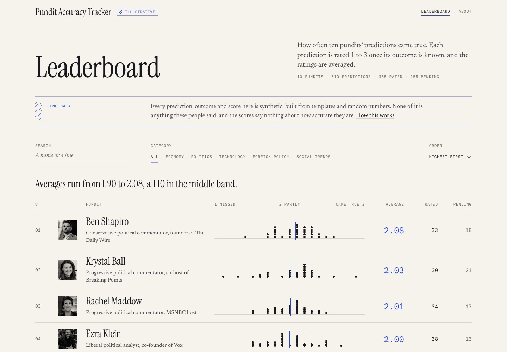

# pundit-accuracy-tracker

A dashboard that scores how often prominent pundits' predictions came true, by category.

**Illustrative only.** Every prediction, outcome and score in this app is synthetic demo data, shown next to real people's names and photos. Nothing here is something they said, and no score says anything about how accurate anyone is. The app carries an "Illustrative" flag on every page.

For a more robust and more recent version of this idea, focused on psychiatry, see [psychiatry-pundit-scorer](https://github.com/itsmartinwho/psychiatry-pundit-scorer) (live at [psych-forecast-ledger.vercel.app](https://psych-forecast-ledger.vercel.app)).

JJ built this in March and April 2025 to ask a simple question: which press personalities get their predictions right? The code calls them SIPPs, short for Strategically Important Press Personalities. Ten are listed. Each has a page with their predictions, a rating for every one that has played out, and their averages by category.

[](https://pundit-accuracy-tracker.vercel.app)

Live: [pundit-accuracy-tracker.vercel.app](https://pundit-accuracy-tracker.vercel.app)

## The data is synthetic

Read this before you trust a number. The predictions in `public/data/sippData.json` are not real. They are sentence templates ("The inflation rate will reach {X}% by {YEAR}") filled in with random numbers, dates and outcomes, and given random ratings. The names and photos are real people's. The predictions are not theirs, and the scores say nothing about how accurate anyone is. The app says so in the flag at the top of every page and in a note on every page with scores.

How it happened: the script that built the data was meant to search the web for real predictions. It read the search response wrongly, so the search failed and it fell back to the templates, and it wrote the result out as data. All 510 predictions in the file match a template from that fallback. The script is gone. `npm run refresh-data` replaces it (below).

## How scoring works

- Each prediction has one category: economy, politics, technology, foreign policy or social trends.
- A prediction whose outcome is known is rated 1 (did not come true), 2 (partly: the right direction, the wrong size or timing) or 3 (came true as stated). One whose outcome is not known yet is pending and is not scored.
- A person's score is the plain average of their ratings. A category score is the average of the ratings in that category, or their overall average if they have none there; the pages show a dash for such a category.
- An average under 1.7 is in the low band, 2.3 and over in the high band, and the rest in the middle.
- There is no weighting for how hard or how specific a prediction was, or for how long it covered.

The app judges nothing. It averages the ratings in the data file (`src/data/loadSipps.ts`, `src/data/predictionAnalysis.ts`), so the leaderboard and the pundits' pages always agree.

Who gave the ratings depends on the data. In data from `refresh-data`, a model with web search finds each prediction, decides whether its outcome is known, and gives the rating. No person checks it. Treat a score as a place to start, and follow the source links.

## Run it

```
npm install
npm run dev
```

Open `http://localhost:8080`. No key is needed: the app reads `public/data/sippData.json` and nothing else.

`npm run build` writes `dist/`, then checks that it holds no API key and no call to `api.openai.com`. If it does, the build fails.

## Refresh the data

You need Node 18 or newer and an OpenAI API key.

```
cp .env.example .env     # then put your key in OPENAI_API_KEY
npm run refresh-data -- --dry-run
npm run refresh-data
```

For each of the ten, one request asks a model with web search for up to 15 predictions made since 2023, with a source link for each and a rating for those that have played out. A second request describes the patterns in the ratings, from the data alone. The default model is `gpt-6-astra`, OpenAI's most capable; set `OPENAI_MODEL` to change it. Expect about twenty requests, and OpenAI bills web search per call.

The script follows a few rules:

- A prediction without a usable source link is dropped.
- Someone with fewer than three rated predictions is left out, not padded.
- If any of the ten fails, nothing is written, unless you pass `--allow-partial`.
- It writes `public/data/sippData.json` with `"kind": "sourced"`. The note in the app then reads "Not fact-checked" instead of "Demo data", and each prediction links its source.

The key is read by the script only. Never name it `VITE_OPENAI_API_KEY` or anything else starting with `VITE_`: Vite copies those into the browser bundle, where anyone can read them.

`npm run refresh-data -- --help` lists the other options.

## Deploy

The site is a static Vite build on Vercel (project `pundit-accuracy-tracker`). Pushing to `main` deploys to production, and every pull request gets a preview. `vercel.json` sends every path to `index.html`, so a pundit's page loads from its own address.

## Design

Newsprint paper, blue-black ink and one accent, an editor's blue pencil, for whatever the page wants read first: an average, the current page, focus. Three faces, one job each, all from Google Fonts in their regular weight: Instrument Serif for names, Newsreader for sentences, IBM Plex Mono in small capitals for labels and figures. The charts are hand-built: each rated prediction is one dot on a 1-to-3 rule, and the average is a pencil line through them.

## Stack

React 18, TypeScript, Vite, Tailwind CSS, shadcn/ui (restyled through the theme tokens), React Router and TanStack Query. The OpenAI SDK is used by the refresh script only.

## Structure

```
src/pages/        the leaderboard, a pundit's page, About, the 404
src/components/   the masthead, the leaderboard rows, the ratings strip, prediction rows, the data note, ui/ (shadcn)
src/lib/          record.ts: what the pages read off a pundit's record (display only)
src/data/         the loader and scoring, and the types
public/data/      sippData.json, the one file the app reads
public/portraits/ the portraits, and small/ copies the pages load
scripts/          refresh-data.mjs (needs a key), check-bundle.mjs
docs/             the screenshot
```

The portraits in `public/portraits/` are photographs of real people. The licence below covers the code, not them. Replace them if you reuse the project.

## Licence

MIT, see [LICENSE](LICENSE).

By José (JJ) Martín Quesada, [@itsmartinwho](https://github.com/itsmartinwho).
